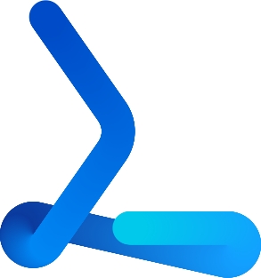

# Muse Gadget Forge

**Muse가 자기 가젯을 직접 만들게 해 주는 스킬.**

[Muse Gadgets](https://gadgets.muse.ai)는 Muse에게 내 방에서 쓸 귀와 입을 줍니다. 화면, 마이크, 스피커, 버튼이 달린
ESP32 하나면 됩니다. 그런데 지금까지 그 가젯을 만드는 건 늘 다른 누군가의 몫이었습니다. 펌웨어를 직접 짜서 굽거나,
노트북의 다른 코딩 에이전트에게 맡기거나. Muse는 페어링 화면 건너편에서 기다리기만 했죠.

Forge는 그 틈을 메웁니다. 그렇다고 대단한 게 들어 있지는 않습니다. Muse에게 건네는 지침 한 장, 스킬일 뿐입니다.
나머지는 이미 다 있으니까요.

- **[Muse Local Gateway](https://github.com/Toddoward/muse-local-gateway)**가 내 컴퓨터 위에 Muse의 작업대를 놓아 줍니다.
  USB에 꽂힌 보드 바로 옆의 격리된 셸입니다.
- **[Muse Gadget SDK](https://github.com/facebookincubator/muse-gadget-sdk)**에는 펌웨어와 보드별 설정, 그리고 에이전트가
  빌드할 수 있도록 쓰인 `AGENTS.md`가 있습니다.

Forge는 Muse가 이 둘을 스스로 엮게 합니다. 작업대에 ESP-IDF를 깔고, 내 보드에 맞는 설정을 고르고, 빌드하고, 굽고,
부팅 로그를 읽고, 깨진 곳을 고칩니다. 그리고 꼭 사람이 해야 하는 마지막 한 단계, Muse 앱에서의 페어링을 건네줍니다.

## 쓰는 법

1. [Muse Local Gateway](https://github.com/Toddoward/muse-local-gateway)를 설치하면서 USB에 **y**라고 답합니다.
2. 보드를 꽂고(ESP32-S3로 시작하면 좋습니다) Muse에게 말합니다.
   > *https://github.com/Toddoward/muse-gadget-forge 에서 muse_gadget_forge 스킬 설치하고, 내 책상에 있는 보드로 가젯 하나 만들어 줘.*
3. [SDK 토큰](https://gadgets.muse.ai)을 준비해 두세요. Muse가 물어봅니다. 굽기 전에도 확인을 구합니다.
   첫 빌드 때는 작업대에 ESP-IDF를 내려받느라 시간이 좀 걸립니다.

게이트웨이 말고는 따로 설치할 게 없습니다. 툴체인은 Muse가 직접 준비합니다.

## Muse가 하는 일과 하지 않는 일

- **굽기 전에 묻고**, 묻지 않고는 보드를 지우지 않습니다(지우면 Wi-Fi 설정과 페어링이 사라집니다).
- 토큰은 대화에도, git에도, 공유 폴더에도 남기지 않습니다.
- 모터·릴레이·발열처럼 움직이거나 뜨거워지는 것은 먼저 분명한 허락을 받습니다.
- 내 토큰으로 만든 가젯은 개인적·비상업적 용도입니다. [Gadget SDK 토큰 약관](https://gadgets.muse.ai/sdk-terms)을 확인하세요.

작업대의 기본 모드(`isolated`)에서 검증했습니다. 프록시를 거쳐 ESP-IDF v6.0.1을 설치하고, USB로 실제 보드를 식별하고,
ESP32-S3 DevKitC-1용 Gadget SDK 펌웨어를 빌드했습니다([`tests/smoke.py`](tests/smoke.py)). 빈 작업대에서 ESP-IDF 준비에
약 3분, 그 뒤로는 빌드 한 번에 1분이 채 안 걸립니다.

## 만든 것들에 대한 감사

- **[Muse Gadgets](https://github.com/facebookincubator/muse-gadget-sdk)** (Meta) — SDK와 펌웨어, 그리고 이 모든 걸 가능하게 한
  에이전트용 `AGENTS.md`. Forge는 Muse에게 그곳을 가리켜 줄 뿐입니다.
- **[ESP-IDF](https://github.com/espressif/esp-idf)**와 **esptool** (Espressif)

Muse Gadget Forge는 **비공식 커뮤니티 프로젝트**이며, Meta가 만들거나 보증하거나 지원하지 않습니다.
"Muse"는 Meta의 이름이고, 무엇과 함께 동작하는지 밝히기 위해서만 씁니다.

## 라이선스

[Apache-2.0](LICENSE)
