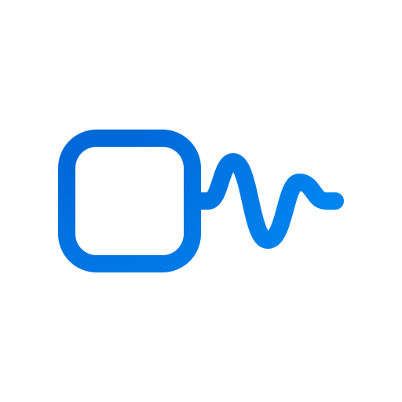

# Muse Gadget Forge

**A skill that lets Muse build its own gadget.**

[Muse Gadgets](https://gadgets.muse.ai) give Muse ears and a voice in your room: an ESP32 with a
screen, a microphone, a speaker, a button. But until now someone else had to build them. You wrote
and flashed the firmware yourself — or handed the job to a coding agent on your laptop — and Muse
waited at the other end of the pairing screen.

Forge closes that gap. It is only a skill, a page of instructions for Muse, because everything else
already exists:

- **[Muse Local Gateway](https://github.com/Toddoward/muse-local-gateway)** gives Muse a workbench on
  your computer — a sandboxed shell beside the board in your USB port.
- **The [Muse Gadget SDK](https://github.com/facebookincubator/muse-gadget-sdk)** has the firmware, the
  board profiles, and an `AGENTS.md` written precisely so that agents can build it.

Forge teaches Muse to put the two together: set up ESP-IDF on its workbench, pick the right profile
for your board, build, flash, read the boot log, fix what broke — and then hand you the one step
that has to be yours, pairing it in the Muse app.

## Use it

1. Set up [Muse Local Gateway](https://github.com/Toddoward/muse-local-gateway) and say **yes** to USB.
2. Plug in your board (an ESP32-S3 is a good start) and tell Muse:
   > *Install the muse_gadget_forge skill from https://github.com/Toddoward/muse-gadget-forge, then
   > build me a gadget for the board on my desk.*
3. Have your [SDK token](https://gadgets.muse.ai) ready — Muse will ask for it — and confirm when it
   asks to flash. The first build downloads ESP-IDF onto the workbench, so give it some time.

Nothing to install on your side beyond the gateway: Muse sets up its own toolchain.

## What Muse will and won't do

- It **asks before flashing**, and never erases a board without asking (that wipes Wi-Fi and pairing).
- Your token stays out of chat, out of git, and out of your shared folder.
- Anything with motors, relays or heat gets your explicit go-ahead first.
- Gadgets built with your token are for personal, non-commercial use — see the
  [Gadget SDK Token Terms](https://gadgets.muse.ai/sdk-terms).

Tested on the workbench in its default `isolated` mode: ESP-IDF v6.0.1 installed through the proxy,
a real board identified over USB, and the Gadget SDK firmware built for the ESP32-S3 DevKitC-1
([`tests/smoke.py`](tests/smoke.py)). From an empty workbench: about 3 minutes to set up ESP-IDF, under a
minute per build after that.

## Credits

- **[Muse Gadgets](https://github.com/facebookincubator/muse-gadget-sdk)** by Meta — the SDK, the firmware,
  and the agent-ready `AGENTS.md` that make this possible. Forge only points Muse at it.
- **[ESP-IDF](https://github.com/espressif/esp-idf)** and **esptool** by Espressif.
- **[Muse Local Gateway](https://github.com/Toddoward/muse-local-gateway)** — the workbench.

Muse Gadget Forge is an **unofficial community project**, not made, endorsed, or supported by Meta.
"Muse" is Meta's name, used here only to say what this works with.

## License

[Apache-2.0](LICENSE)
